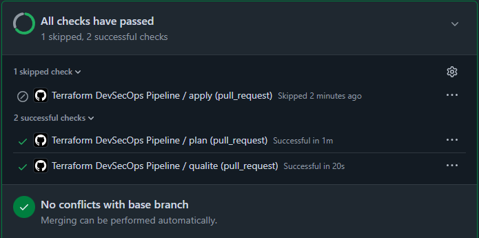
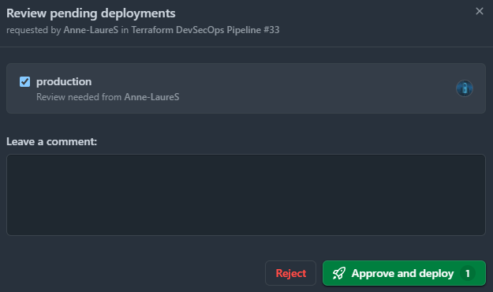
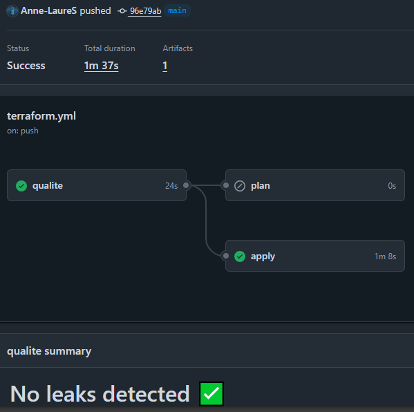
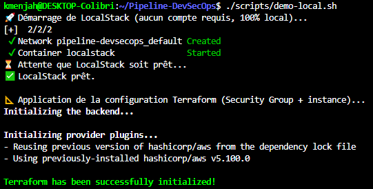
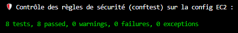
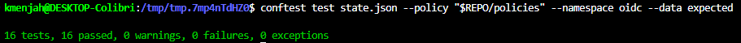
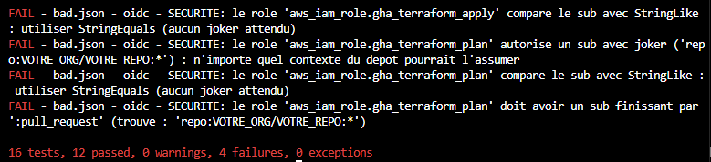

# 🛡️ Pipeline DevSecOps de bout en bout


> 🛠️ **Projet — IaC, IAM & Policy as Code**

> 📘 **Le rapport est le document de référence** : [`docs/rapport.md`](docs/rapport.md) explique la
> démarche, les décisions de conception (et celles qui ont changé), les preuves capturées, l'audit
> OWASP Top 10 CI/CD et les limites assumées. **Ce README est le mode d'emploi ; le rapport est
> l'argumentaire.** [Aller directement aux parties du rapport ↓](#-le-rapport)

## 🧭 En 2 minutes

**Le sujet.** Comment un pipeline GitHub Actions peut-il déployer de l'infrastructure sur AWS
**sans qu'aucune clé d'accès ne soit stockée** nulle part, et comment s'assurer, automatiquement,
qu'une configuration dangereuse est refusée avant d'arriver en production ?

**La réponse de ce dépôt.**

1. **Pas de secret permanent** : GitHub prouve l'identité du job à AWS avec un jeton signé de courte
   durée (OIDC), que AWS échange contre des credentials temporaires.
2. **Deux identités AWS distinctes** : l'une ne peut que *lire* (pour le `plan`), l'autre peut
   *écrire* (pour le `apply`) et n'est accessible qu'à un job passant par l'environment protégé
   `production`.
3. **Des règles écrites en code** (*policy as code*) qui bloquent une configuration non conforme,
   y compris une identité trop permissive.

Les termes techniques sont définis dans le [glossaire](docs/rapport.md#glossaire).

**Pour comprendre le « pourquoi » et pas seulement le « comment »**, lisez le
[rapport](docs/rapport.md), en particulier l'[évolution de conception du rôle `apply`](docs/rapport.md#evolution-sub-apply)
et l'[audit OWASP](docs/rapport.md#partie-4).

**Ce qui est réel et ce qui ne l'est pas.** Il n'y a pas de compte AWS derrière ce projet : tout
tourne contre **LocalStack**, un AWS émulé en local. LocalStack n'applique pas les conditions de
sécurité IAM (il accepte n'importe quel jeton, voir plus bas). La configuration OIDC est donc
**écrite, vérifiée statiquement et simulée, mais jamais exercée sur un vrai AWS**.

| | Statut |
|---|---|
| `fmt`, Gitleaks, Trivy, `terraform plan`, règles EC2 | ✅ testés de bout en bout, sur une vraie pull request |
| Règles sur les trust policies OIDC | ✅ vérifiées sur le state, tests unitaires, CI |
| Décision d'AWS (qui peut assumer quel rôle) | 🟡 **simulée**, pas observée |
| `AssumeRoleWithWebIdentity` réel | ❌ jamais exercé (pas de compte AWS) |

---

## 📑 Sommaire

0. [**Le rapport**](#-le-rapport) — démarche, preuves, audit, décisions
1. [Prérequis](#-prérequis)
2. [Ce que fait ce pipeline](#-ce-que-fait-ce-pipeline)
3. [Conception IAM](#-conception-iam--pourquoi-ce-design)
4. [Structure du dépôt](#-structure-du-dépôt)
5. [Démo live](#-démo-live-sans-compte-aws)
6. [Tester pas à pas](#-tester-pas-à-pas)
7. [Les règles de sécurité EC2](#-les-règles-de-sécurité-sur-le-plan)
8. [Les règles sur les rôles OIDC](#-les-règles-sur-les-rôles-oidc-trust-policies-et-permissions)
9. [Ce que LocalStack n'applique pas, et la simulation](#-ce-que-localstack-napplique-pas--et-la-simulation)
10. [Limites et risques assumés](#limites)

> 📖 Un terme vous échappe (OIDC, trust policy, claim `sub`, state…) ? Voir le
> [glossaire du rapport](docs/rapport.md#glossaire).

---

## 📘 Le rapport

[`docs/rapport.md`](docs/rapport.md) est le livrable principal : il documente **pourquoi** le dépôt est
fait ainsi, avec les preuves.

| Partie | Ce que vous y trouvez |
|---|---|
| [Glossaire](docs/rapport.md#glossaire) | OIDC, rôle IAM, trust policy, claims, state, policy as code, LocalStack |
| [0 — Note méthodologique](docs/rapport.md#partie-0) | Pourquoi LocalStack, et ce que cela implique pour la confiance accordée aux résultats |
| [1 — Politique OIDC](docs/rapport.md#partie-1) | Les conditions `sub` finales, le schéma d'architecture, le test négatif (scénario d'attaque détaillé) |
| [1 — Évolution de conception](docs/rapport.md#evolution-sub-apply) | Pourquoi le `sub` du rôle `apply` vise l'environment et non `main`, et comment l'erreur a été trouvée |
| [1 — Vérification automatisée](docs/rapport.md#verification-automatisee) | Les règles Rego, le constat LocalStack (il accepte n'importe quel jeton), la simulation et ses limites |
| [2 — Plan commenté sur PR](docs/rapport.md#partie-2) | Capture du commentaire automatique de plan |
| [3 — Messages de refus](docs/rapport.md#partie-3) | Les 4 règles EC2 testées négativement puis positivement |
| [4 — Audit OWASP Top 10 CI/CD](docs/rapport.md#partie-4) | Dix risques, ce qui est en place, ce qui reste (risques résiduels assumés) |
| [5 — Saltzer & Schroeder](docs/rapport.md#partie-5) | Fail-safe defaults, least privilege, complete mediation appliqués au dépôt |

> 💡 **Le README dit ce que fait le dépôt et comment le rejouer ; le rapport dit pourquoi, ce qui a
> été corrigé en route, et ce qui n'est pas prouvé.**

---

## 🧰 Prérequis

| Outil | Rôle | Vérifier |
|---|---|---|
| Docker (avec Compose) | Lancer LocalStack | `docker --version` |
| Terraform ≥ 1.9 | Plan / apply | `terraform version` |
| Conftest ≥ 0.55 | Évaluer les règles Rego | `conftest --version` |
| `aws` CLI *(facultatif)* | Détail de la démo, reproduction du constat LocalStack | `aws --version` |

> 💡 Si `terraform` est installé via **snap** et que le shell répond « command not found » :
> `export PATH="$PATH:/snap/bin"`.

Aucun compte AWS ni compte LocalStack n'est nécessaire.

---

## 🎯 Ce que fait ce pipeline

| Étape | Outil | Rôle |
|---|---|---|
| 🧹 Qualité | `terraform fmt`, Gitleaks, Trivy | Contrôles bloquants avant tout `plan` |
| 📐 Plan | Terraform + LocalStack | Génère et affiche le plan d'infrastructure |
| 🚦 Policy as Code | Conftest / OPA | Bloque toute ressource non conforme (4 règles) et toute trust policy ou permission OIDC trop large (règles + simulation) |
| 💬 Revue | Commentaire automatique sur PR | Le plan est visible avant merge |
| ✅ Apply | Environment `production` | Approbation manuelle requise (reviewer obligatoire, déploiement limité à `main`) |
| 🔑 Authentification | OIDC GitHub ↔ AWS | Conçue et vérifiée statiquement ; **non exercée** (pas de compte AWS), le CI utilise LocalStack |

Résultat sur une pull request réelle (règles EC2, règles OIDC et simulation incluses) :



Après le merge sur `main`, le job `apply` attend l'approbation du reviewer de l'environment
`production` :



Une fois approuvé, il s'exécute (toujours contre LocalStack) :



---

## 🔐 Conception IAM — pourquoi ce design

Le cœur de ce pipeline n'est pas Terraform, c'est le modèle d'accès qui l'entoure. Détail dans
[`terraform/oidc.tf`](terraform/oidc.tf) et dans le [rapport](docs/rapport.md) :

- **Zéro credential permanent** : fédération OIDC GitHub Actions ↔ AWS. Aucune clé d'accès stockée
  en secret GitHub — le job obtient des credentials STS valables 1 h maximum (`max_session_duration`).
- **Deux rôles, pas un** : `gha-terraform-plan` (lecture) et `gha-terraform-apply` (écriture) sont
  des identités IAM distinctes. Un job déclenché par une pull request reçoit un jeton dont le `sub`
  est `…:pull_request` : la trust policy du rôle d'écriture ne l'accepte pas, même si le workflow
  est modifié dans cette PR.
- **Confiance scopée par le contenu du jeton, pas seulement sa provenance** : la trust policy
  vérifie le claim `sub` :

  | Rôle | `sub` accepté | Pourquoi |
  |---|---|---|
  | `gha-terraform-plan` | `repo:<ORG>/<REPO>:pull_request` | une PR de ce dépôt, lecture seule |
  | `gha-terraform-apply` | `repo:<ORG>/<REPO>:environment:production` | un job de ce dépôt déclarant `environment: production` |

  La comparaison se fait en **`StringEquals`** (valeur exacte) et non en `StringLike` : aucun joker
  n'est voulu, et un `*` ajouté plus tard resterait un caractère littéral au lieu d'élargir la
  confiance en silence. La règle 2 bis refuse tout opérateur à motif sur le `sub`.

- **Pourquoi l'environment pour `apply` et non la branche `main`** : dès qu'un job déclare
  `environment:`, GitHub remplace le `sub` par `…:environment:<nom>` (le ref n'y figure plus). Une
  condition sur `ref:refs/heads/main` aurait donc **refusé** le job `apply`. La première
  version de ce dépôt visait le ref ; la condition a évolué et un test de régression couvre
  l'ancien `sub`. En contrepartie, l'environment doit être configuré côté GitHub (*Settings →
  Environments → production*) avec des **reviewers obligatoires** et des **Deployment branches
  limitées à `main`** : sans cela, n'importe quelle branche pourrait cibler cet environment.
  Cette configuration est en place sur ce dépôt (reviewer obligatoire, branches limitées à `main`,
  administrateurs non exemptés), et `main` n'accepte que des pull requests (ruleset `protect-main` : PR obligatoire, checks `qualite`
  et `plan` requis, branche à jour avant merge).
  Ces réglages vivent dans GitHub et non dans le dépôt : ils sont à reproduire sur un fork.
- **Le test négatif fait partie de la démarche** : le [rapport](docs/rapport.md) documente ce qui se
  passerait si la condition `sub` était élargie à `repo:<ORG>/<REPO>:*` (n'importe quel contexte du
  dépôt pourrait assumer le rôle) ; ce scénario est désormais rejoué automatiquement par les règles
  et la simulation.
- **Les risques résiduels sont assumés** (détail dans [Limites](#limites)) :
  permissions limitées à EC2 et à une région, écritures sur les seules ressources étiquetées
  `ManagedBy=terraform` (règles 6 à 10 contre toute régression).

---

## 📁 Structure du dépôt

```
.
├── .github/workflows/
│   ├── terraform.yml        # Pipeline principal (qualité → plan → apply)
│   └── oidc-check.yml       # Contrôle OIDC sur un VRAI compte AWS (déclenchement manuel)
├── terraform/
│   ├── oidc.tf              # Provider OIDC + rôles IAM plan/apply
│   └── examples/            # Ressources de démo testées contre LocalStack
├── policies/
│   ├── securite.rego        # 4 règles de sécurité sur le plan (Conftest/OPA)
│   ├── securite_test.rego   # tests unitaires de ces règles, un par contournement connu
│   ├── oidc.rego            # règles sur les trust policies et les permissions (lues dans le state)
│   ├── oidc_test.rego       # tests unitaires de ces règles, un par contournement connu (hors ligne)
│   ├── oidc_simulation.rego # simulation de la décision AssumeRoleWithWebIdentity (10 jetons)
│   └── oidc_simulation_test.rego  # tests du moteur de simulation
├── docs/
│   ├── rapport.md       # Rapport : démarche, preuves, audit, décisions
│   ├── oidc-architecture.svg
│   └── captures/            # Preuves visuelles
├── scripts/
│   └── demo-local.sh        # Démo locale : LocalStack + apply + contrôles (option : cleanup)
├── .trivyignore             # Risques acceptés, justifiés et tracés
├── docker-compose.yml       # LocalStack pour tester en local
└── .gitignore
```

---

## 🎥 Démo live (sans compte AWS)

```bash
./scripts/demo-local.sh          # lance LocalStack + apply + contrôles
./scripts/demo-local.sh cleanup  # détruit tout et arrête LocalStack
```



La démo enchaîne :

1. création d'un Security Group et d'une instance EC2 sur LocalStack ;
2. contrôle Conftest de cette configuration (règles EC2) ;
3. application de `terraform/oidc.tf` dans un dossier temporaire, puis contrôle des trust policies
   des deux rôles ;
4. **simulation** de la décision d'AWS sur 10 jetons fictifs ;
5. **refus volontaire** : le `sub` du rôle `plan` est élargi à `:*` dans une copie du state, les
   règles le bloquent et la simulation montre qu'un push sur `main` assumerait ce rôle.

> ⚠️ Relancer la démo sans `cleanup` échoue : LocalStack n'implémente pas la modification des
> options de metadata d'une instance existante (erreur 501).

---

## 🚀 Tester pas à pas

Tout se lance depuis la racine du dépôt.

### 1. Règles unitaires, hors ligne (rien à démarrer)

```bash
conftest verify --policy policies
```

Résultat attendu : **87 tests unitaires**, 0 failure.


### 2. Règles EC2 sur un plan

```bash
docker compose up -d                       # LocalStack
cd terraform/examples
terraform init
terraform plan -out=tfplan.binary
terraform show -json tfplan.binary > tfplan.json
conftest test tfplan.json --policy ../../policies
cd ../..
```

Résultat attendu : **13 contrôles** (les 4 règles EC2), 0 failure.



### 3. Trust policies OIDC sur un state, avec refus volontaire

```bash
REPO="$(pwd)"                               # racine du dépôt
WORK="$(mktemp -d)"
cp terraform/oidc.tf terraform/examples/provider.tf "$WORK/" && cd "$WORK"
terraform init && terraform apply -auto-approve
terraform show -json > state.json

# Dépôt attendu fourni séparément (valeur par défaut de oidc.tf) : active la règle 5 bis,
# comme dans la démo et dans le CI
mkdir expected && echo '{"expected_repo":"VOTRE_ORG/VOTRE_REPO"}' > expected/expected.json

# Cas conforme
conftest test state.json --policy "$REPO/policies" --namespace oidc --data expected
conftest test state.json --policy "$REPO/policies" --namespace oidc_sim --data expected

# Violation volontaire : l'opérateur passe en StringLike ET le sub est élargi à ':*'
sed 's/\\"StringEquals\\":{/\\"StringLike\\":{/g; s/:pull_request/:*/g' state.json > bad.json
conftest test bad.json --policy "$REPO/policies" --namespace oidc --data expected       # 4 violations
conftest test bad.json --policy "$REPO/policies" --namespace oidc_sim --data expected   # 1 violation

terraform destroy -auto-approve && cd "$REPO" && docker compose down
```

Résultat attendu sur le cas conforme : **16 contrôles** (`oidc`) et **13** (`oidc_sim`), 0 failure.



Résultat attendu sur la violation volontaire : **4 violations** (`sub` en `:*`, `StringLike` sur les
deux rôles, suffixe attendu absent) et 1 pour la simulation (un push sur `main` assumerait le rôle
`plan`).



---

## 🔒 Les règles de sécurité sur le plan

| # | Règle | Détecte |
|---|---|---|
| 1️⃣ | 🚫 Pas de SSH ouvert à Internet | port 22 (ou plage l'incluant, ou **tout le trafic** `-1`) ouvert à `0.0.0.0/0` **ou** `::/0`, sur `aws_security_group`, `aws_security_group_rule` et `aws_vpc_security_group_ingress_rule` |
| 2️⃣ | 🔐 IMDSv2 obligatoire | `http_tokens` ≠ `"required"`, **absent ou inconnu au plan**, ou bloc `metadata_options` manquant |
| 3️⃣ | 💾 Chiffrement des disques | `encrypted` ≠ `true`, **absent ou inconnu**, ou instance **sans** `root_block_device` ; vaut aussi pour `ebs_block_device` et `aws_ebs_volume` |
| 4️⃣ | 🏷️ Tags obligatoires | `Environment`, `Owner`, `ManagedBy` manquants, ou aucun tag |

**Principe : ce qui n'est pas vérifiable est refusé.** Terraform omet du plan les valeurs calculées à
l'apply : une règle qui compare une valeur absente ne se déclenche jamais. Ces règles échouent donc
quand la valeur est inconnue plutôt que de la prendre pour conforme.

**Vocabulaire.** Une *règle* est un contrôle de sécurité nommé (la table ci-dessus). Conftest compte
des *contrôles* : un bloc `deny` par cas détecté, donc plusieurs par règle. Un *test unitaire* est un
`test_*` Rego rejoué hors ligne par `conftest verify`. C'est pourquoi 4 règles produisent plus de
contrôles et que les tests unitaires sont plus nombreux encore.

Chaque règle est testée **négativement** puis **positivement**, à deux niveaux : sur un plan réel
(violation volontaire, message de refus capturé) et par des tests unitaires
([`securite_test.rego`](policies/securite_test.rego)), un par contournement connu. Détail dans le
[rapport](docs/rapport.md#partie-3).

---

## 🔑 Les règles sur les rôles OIDC (trust policies et permissions)

[`policies/oidc.rego`](policies/oidc.rego) vérifie le **contenu** des trust policies et des
permissions des rôles, sans compte AWS :

| # | Règle | Détecte |
|---|---|---|
| 1️⃣ | 🚫 Pas de joker dans le `sub` | `repo:<ORG>/<REPO>:*` (n'importe quel contexte du dépôt) |
| 2️⃣ | 🎯 Dépôt explicite | `sub` absent, ou `repo:*/<REPO>:...` |
| 2️⃣bis | 🔤 `sub` comparé en `StringEquals` | `StringLike` (ou tout opérateur à motif) sur le `sub` : un `*` futur élargirait la confiance en silence |
| 3️⃣ | 🔀 Contexte attendu par rôle | `plan` ≠ `:pull_request`, ou `apply` ≠ `:environment:production` |
| 4️⃣ | 🎫 Audience exacte | `aud` différent de `sts.amazonaws.com` |
| 5️⃣ | 👤 Pas de `Principal "*"` | trust policy ouverte à toute identité |
| 5️⃣bis | 🧭 Dépôt attendu fourni de l'extérieur | `sub` ciblant un autre dépôt que `expected_repo` (voir ci-dessous) |
| 6️⃣ | 🧱 Pas d'action joker de service | `ec2:*`, `s3:*`, `*` |
| 6️⃣bis | 🧱 Pas de joker partiel hors lecture | `ec2:Run*`, `ec2:Delete*`… (seuls `Describe*` / `List*` / `Get*` sont tolérés) |
| 7️⃣ | 📖 Lecture seule vraiment en lecture | `s3:Get*` ou `logs:Get*` (couvrent `GetObject`, `GetLogEvents`) pour le rôle `plan` |
| 8️⃣ | 🎯 `Resource "*"` réservé à la lecture | une action d'écriture sur `Resource "*"` |
| 9️⃣ | 🚫 Pas de `NotAction` / `NotResource` | un `Allow` + `NotAction` autorise « presque tout » |
| 🔟 | 🔍 Pas de policy qu'on ne peut pas lire | policy managée AWS (`AdministratorAccess`…), externe, `managed_policy_arns`, `inline_policy` |

**Ce qui est examiné.** Les règles 6 à 10 portent sur les policies **réellement attachées** à un rôle
assumable par GitHub (`aws_iam_role_policy_attachment`, `aws_iam_policy_attachment`,
`aws_iam_role_policy`), et non sur les policies dont le nom commence par un préfixe : un nom ne prouve
rien. Une policy attachée mais illisible est refusée, on ne valide pas ce qu'on ne voit pas.

**Dépôt attendu indépendant.** Sans donnée externe, la simulation déduirait le dépôt de référence du
`sub` du rôle testé (vérification circulaire : un mauvais dépôt passerait). On fournit donc
`expected_repo` séparément, avec `--data` :

```bash
mkdir expected && echo '{"expected_repo":"<org>/<repo>"}' > expected/expected.json
conftest test state.json --policy policies --namespace oidc --data expected
```

Le CI le fournit lui-même (`GITHUB_REPOSITORY`) et la démo utilise les valeurs par défaut de
`oidc.tf`. Sans `--data`, la règle 5bis est inactive et la déduction circulaire s'applique.

**Particularité** : ces règles lisent le **state** (`terraform show -json` après un apply sur
LocalStack) et non le plan. Dans un plan, `assume_role_policy` dépend de l'ARN du provider OIDC, qui
n'existe pas avant l'apply : le champ est « inconnu » et invisible pour Conftest.

---

## 🧪 Ce que LocalStack n'applique pas — et la simulation

**Constat.** On pourrait croire que LocalStack permet de « faire marcher » l'OIDC sans compte AWS.
Ce n'est pas le cas : il renvoie des credentials pour **n'importe quel jeton**, sans vérifier la
signature ni les conditions `sub` / `aud`. Test réalisé sur les rôles de `oidc.tf` appliqués à
LocalStack 4.4.0 (jetons fictifs non signés) :

| Jeton | Décision d'AWS | LocalStack |
|---|---|---|
| PR du bon dépôt → rôle `plan` | accepté | accepté |
| **PR d'un autre dépôt** → rôle `plan` | **refusé** | **accepté** ❌ |
| **PR du bon dépôt** → rôle `apply` | **refusé** | **accepté** ❌ |
| **Mauvaise audience** (`aud` ≠ `sts.amazonaws.com`) → rôle `plan` | **refusé** | **accepté** ❌ |
| **Jeton sans claim `sub`** → rôle `apply` | **refusé** | **accepté** ❌ |

Un `AssumeRole` réussi sur LocalStack ne prouve donc rien sur la sécurité du design.

<details>
<summary>Reproduire le constat</summary>

À lancer pendant l'étape 3 de [Tester pas à pas](#-tester-pas-à-pas), **avant** le
`terraform destroy` (LocalStack démarré et `oidc.tf` appliqué). Nécessite l'`aws` CLI.

```bash
b64() { printf '%s' "$1" | base64 -w0 | tr '+/' '-_' | tr -d '='; }
jwt() { echo "$(b64 '{"alg":"none","typ":"JWT"}').$(b64 "$1").c2ln"; }
export AWS_ACCESS_KEY_ID=test AWS_SECRET_ACCESS_KEY=test AWS_DEFAULT_REGION=eu-west-3
aws --endpoint-url=http://localhost:4566 sts assume-role-with-web-identity \
  --role-arn arn:aws:iam::000000000000:role/gha-terraform-plan \
  --role-session-name test-session \
  --web-identity-token "$(jwt '{"aud":"sts.amazonaws.com","sub":"repo:attaquant/evil:pull_request"}')"
# -> credentials renvoyés, alors qu'AWS refuserait

# Variantes : remplacer le jeton par l'un de ces JSON (même résultat : accepté)
#   {"aud":"autre.example.com","sub":"repo:VOTRE_ORG/VOTRE_REPO:pull_request"}   # mauvaise audience
#   {"aud":"sts.amazonaws.com"}                                                  # sans sub, vers gha-terraform-apply
```
</details>

**La simulation.** Faute de pouvoir interroger AWS,
[`policies/oidc_simulation.rego`](policies/oidc_simulation.rego) rejoue l'évaluation documentée
d'AWS sur 10 jetons fictifs et vérifie que chaque rôle les accepte ou les refuse comme prévu :

| Jeton fictif | Rôle | Attendu |
|---|---|---|
| PR du dépôt | `plan` | accepté |
| Job du dépôt sur l'environment `production` | `apply` | accepté |
| PR du dépôt | `apply` | refusé |
| Push sur `main` du dépôt | `plan` | refusé |
| Push sur `main` **sans** environment | `apply` | refusé |
| Job du dépôt sur un autre environment | `apply` | refusé |
| Push sur une branche quelconque | `apply` | refusé |
| PR d'un fork (autre organisation) | `plan` | refusé |
| Environment `production` d'un fork | `apply` | refusé |
| PR du dépôt, mauvaise audience | `plan` | refusé |

```bash
conftest test state.json --policy policies --namespace oidc_sim
```

Moteur modélisé : statements `Allow` et `Deny` (un `Deny` explicite l'emporte), opérateurs
`StringEquals`, `StringEqualsIgnoreCase`, `StringLike`, `StringNotEquals`, `StringNotLike`, ET entre
les conditions, OU entre les valeurs d'une clé, clé absente = faux pour un opérateur positif et vrai
pour un négatif.

Les règles de la section précédente contrôlent la *forme* des policies ; la simulation contrôle leur
*effet*. Sur le state avec `sub` en `:*`, elle signale qu'un push sur `main` assumerait le rôle
`plan`.

> ⚠️ **C'est une simulation, pas AWS.** Tout opérateur non modélisé (`ForAnyValue:`, `IfExists`,
> `Bool`...) est **signalé** (« simulation non concluante ») plutôt qu'ignoré. Les SCP et
> permission boundaries ne sont pas modélisés ; la signature du jeton et le thumbprint ne sont pas
> vérifiés.

---

<a id="limites"></a>
## ⚠️ Limites et risques assumés

**Pas de compte AWS réel.** Ce projet est réalisé sans compte AWS : je n'en ai pas créé, pour éviter
tout coût.

- ✅ `fmt`, Gitleaks, Trivy, `terraform plan`, Conftest : testés de bout en bout sur une vraie pull
  request GitHub.
- ⚠️ La logique OIDC n'a **jamais été exercée en conditions réelles**. Elle est vérifiée
  statiquement et simulée : cela prouve que les conditions sont bien posées, pas qu'AWS les applique.
- ⚠️ Le CI n'utilise pas l'OIDC : le job `plan` tourne contre LocalStack. Le workflow
  [`oidc-check.yml`](.github/workflows/oidc-check.yml), à lancer à la main, est prévu pour un vrai
  compte (il échoue tant que `ACCOUNT_ID` n'est pas renseigné).

**Moindre privilège.** Les permissions sont limitées à ce que la stack gère (EC2 : Security Group +
instance), à une région, avec écritures sur les seules ressources étiquetées `ManagedBy=terraform`.
Risques résiduels connus :

- **Jamais testées sur un vrai compte** : un rôle `apply` trop étroit échouerait au premier vrai
  déploiement. À valider avec IAM Access Analyzer (génération de policy depuis CloudTrail).
- `ec2:Describe*` reste large (non scopable par ARN) et `DescribeInstanceAttribute` peut exposer le
  `userData` d'une instance : ne jamais y mettre de secret.
- `ec2:CreateTags` n'est pas conditionné : un job `apply` pourrait étiqueter une ressource
  `ManagedBy=terraform` pour l'inclure dans son périmètre.
- Tout service ajouté (S3, RDS, IAM...) doit l'être avec ses actions nommées et ses ARN, pas en
  joker : les règles 6 à 10 le vérifient.
- Les variables `github_org` / `github_repo` valent encore `VOTRE_ORG` / `VOTRE_REPO` : à renseigner
  avant tout vrai déploiement.

Ces choix et les risques qui en découlent sont détaillés dans la
[partie 0](docs/rapport.md#partie-0) et l'[audit OWASP de la partie 4](docs/rapport.md#partie-4) du
[rapport](docs/rapport.md).
