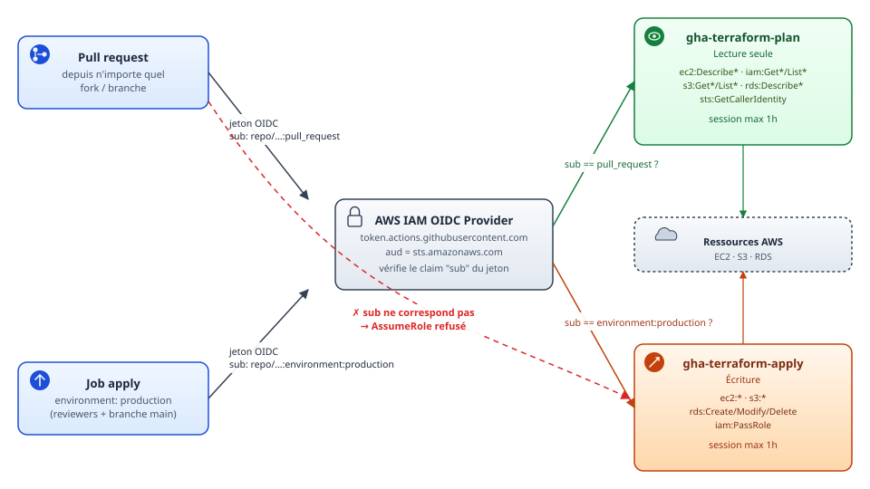
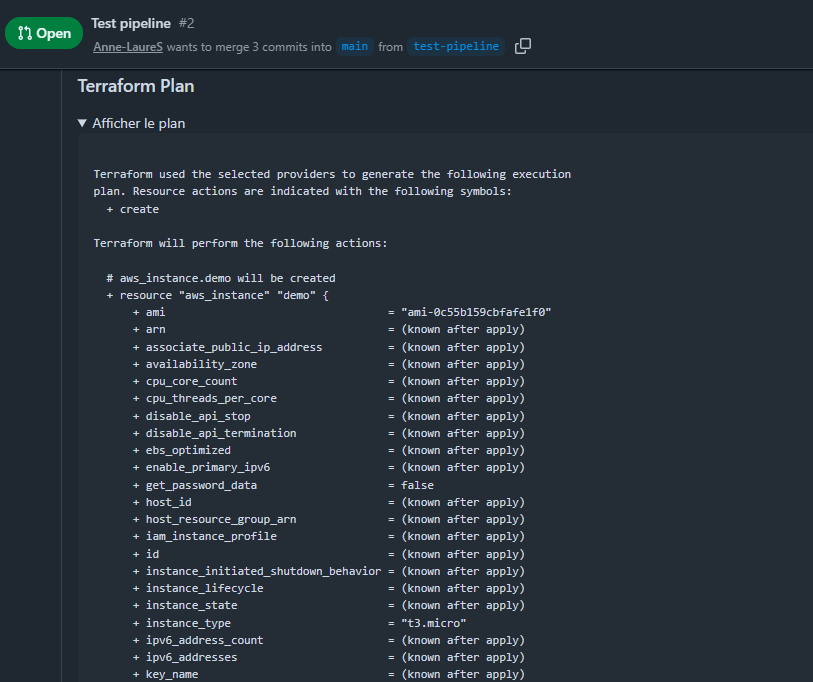

# 🛡️ Pipeline DevSecOps de bout en bout — Rapport

<a id="partie-0"></a>
## 📝 0. Note méthodologique — pourquoi LocalStack

Ce projet n'utilise pas de compte AWS : je n'ai pas voulu en créer un
personnel et payant. J'ai donc fait tourner la partie
"infrastructure exécutable" du pipeline (`terraform plan`/`apply`,
`conftest`) contre **LocalStack** 🐳 (émulation locale de l'API AWS
via Docker, gratuite, sans donnée réelle), plutôt que contre un vrai
compte. Conséquences assumées, à lire en regard de la partie 4 :

- ⚠️ Le provider OIDC GitHub → AWS et les deux rôles IAM
  (`terraform/oidc.tf`) sont écrits, commentés et corrects du point de
  vue du code, mais **n'ont jamais été appliqués ni exercés en
  conditions réelles** : je n'ai pas de preuve d'exécution que
  `AssumeRoleWithWebIdentity` fonctionne, ni que la condition `sub`
  bloque effectivement un contexte non autorisé sur un vrai compte.
- ⚠️ LocalStack Community n'émule pas l'application réelle des
  politiques IAM (permissions "à blanc" au niveau du moteur), donc le
  test négatif de la partie 1 (élargir `sub` à `repo:*` et constater
  l'impact) a été traité comme une analyse écrite plutôt que comme une
  démonstration live. Il est depuis complété par un contrôle **statique**
  automatisé (voir la partie 1, « Vérification automatisée ») : cela
  prouve que la condition est correctement posée, pas qu'AWS l'applique.
- ✅ En revanche, tout ce qui ne dépend pas d'IAM réel — `terraform
  fmt`, `gitleaks`, `trivy config`, le `terraform plan` généré, et
  surtout **`conftest` qui bloque bien sur les 4 règles de policy** —
  a été testé de bout en bout, PR réelle à l'appui.

---

<a id="partie-1"></a>
## 🔐 1. Politique de confiance OIDC finale (commentée)

Voir `terraform/oidc.tf`. Extrait de la condition finale, rôle apply :

```hcl
condition {
  test     = "StringLike"
  variable = "token.actions.githubusercontent.com:sub"
  # Restreint strictement l'assomption du rôle aux jobs de CE dépôt
  # qui déclarent `environment: production`. Empêche toute PR, fork ou
  # branche d'obtenir des droits d'écriture. NB : un job qui déclare un
  # environment reçoit sub=...:environment:<nom> et non ...:ref:...,
  # d'où cette condition (voir « Évolution de conception » ci-dessous).
  values   = ["repo:<ORG>/<REPO>:environment:production"]
}
```

Rôle plan, lecture seule, restreint aux événements `pull_request` :

```hcl
values = ["repo:<ORG>/<REPO>:pull_request"]
```

<figure>
  
  <figcaption><i>Deux contextes GitHub, deux conditions <code>sub</code> distinctes, deux rôles isolés — une PR ne peut
  physiquement pas atteindre le rôle d'écriture, condition vérifiée par AWS lui-même à l'<code>AssumeRole</code>.</i></figcaption>
</figure>

### 🧪 Test négatif

**Condition testée :** `repo:<ORG>/<REPO>:*`

**💥 Ce qu'un attaquant pourrait faire avec cette condition élargie :**
- Toute personne pouvant déclencher un run sur le dépôt — y compris via
  un `workflow_dispatch` sur une branche non protégée, ou un push sur
  n'importe quelle branche — pourrait assumer le rôle, y compris le
  rôle d'écriture s'il partageait cette même condition large.
- Un contributeur externe capable d'ouvrir une PR modifiant un workflow
  (si les workflows ne sont pas protégés par CODEOWNERS) pourrait
  injecter un step exécutant `aws sts get-caller-identity` puis
  exfiltrer les credentials temporaires vers un service tiers.
- Combiné à un rôle trop permissif (ex : `apply` avec `iam:PassRole` ou
  `iam:*`), cela ouvre une voie d'escalade de privilèges complète :
  création de nouvelles identités, modification de politiques,
  persistance dans le compte AWS.
- Le caractère temporaire du jeton (max 1h ici) limite la fenêtre
  d'exploitation mais ne l'annule pas : 1h suffit pour créer une
  porte dérobée (utilisateur IAM avec clé d'accès longue durée, par
  exemple), qui elle sera permanente.

**✅ Remédiation appliquée :** condition restaurée à `pull_request` /
`environment:production` (cf. fichier Terraform final), + protection de
branche `main` exigeant une review avant merge et environment
`production` limité à `main` avec reviewers obligatoires, empêchant
qu'un contributeur modifie seul les workflows qui déploient.

<a id="evolution-sub-apply"></a>
### 🔄 Évolution de conception : le `sub` du rôle apply

La première version de la condition du rôle `apply` visait
`repo:<ORG>/<REPO>:ref:refs/heads/main`. Or le job `apply` du workflow
déclare `environment: production` : GitHub place alors
`repo:<ORG>/<REPO>:environment:production` dans le claim `sub` (le ref
n'y figure plus). Sur un vrai compte, AWS aurait donc **refusé** ce job.
L'erreur était invisible tant que tout tournait contre LocalStack, qui
n'évalue pas les conditions. La condition vise désormais l'environment
`production`, et un test de régression (`oidc_test.rego`) signale
l'ancien `sub`. Prérequis côté GitHub : reviewers obligatoires et
« Deployment branches » limitées à `main` sur cet environment.

<a id="verification-automatisee"></a>
### 🤖 Vérification automatisée des trust policies

Le test négatif ci-dessus n'est plus seulement décrit : il est rejoué
par des règles Rego (`policies/oidc.rego`, tests unitaires dans
`policies/oidc_test.rego`) qui contrôlent le contenu des trust
policies (règles 1 à 5) et des permissions (règles 6 à 10) des rôles,
**sans compte AWS** :

| # | Règle | Détecte |
|---|---|---|
| 1 | Pas de joker dans le `sub` | `repo:<ORG>/<REPO>:*` |
| 2 | Dépôt explicite | `sub` absent, ou `repo:*/<REPO>:...` |
| 3 | Contexte attendu par rôle | `plan` ≠ `:pull_request`, `apply` ≠ `:environment:production` |
| 4 | Audience exacte | `aud` ≠ `sts.amazonaws.com` |
| 5 | Pas de `Principal "*"` | trust policy ouverte à toute identité |
| 5 bis | Dépôt attendu fourni de l'extérieur | `sub` ciblant un autre dépôt que `expected_repo` (donnée indépendante) |
| 6 | Pas d'action joker de service | `ec2:*`, `s3:*`, `*` |
| 6 bis | Pas de joker partiel hors lecture | `ec2:Run*`, `ec2:Delete*`… |
| 7 | Lecture seule vraiment en lecture | `s3:Get*`, `logs:Get*` pour le rôle `plan` |
| 8 | `Resource "*"` réservé à la lecture | action d'écriture sur `Resource "*"` |
| 9 | Pas de `NotAction` / `NotResource` | un `Allow` + `NotAction` autorise « presque tout » |
| 10 | Pas de policy illisible | policy managée AWS, externe, `managed_policy_arns`, `inline_policy` |

Les règles 6 à 10 examinent les policies **réellement attachées** à un
rôle assumable par GitHub (et non celles dont le nom porte un préfixe) ;
une policy attachée qu'on ne peut pas lire (managée AWS, externe) est
refusée. Cette portée a été élargie après que des contournements ont
été identifiés et testés : `NotAction`, `AdministratorAccess` attachée,
policy au nom anodin, joker partiel. Chacun a désormais un test négatif.

Particularité : ces règles lisent le **state** (`terraform show -json`
après un apply contre LocalStack) et non le plan, car
`assume_role_policy` y est inconnu avant l'apply (il dépend de l'ARN du
provider OIDC). Le job `plan` du pipeline les exécute à chaque pull
request, et `scripts/demo-local.sh` les rejoue en direct, y compris le
refus volontaire du `sub` en `:*`.

Tests unitaires (hors ligne) :


Trust policies conformes sur un vrai state :


Refus volontaire du `sub` élargi à `:*` (2 violations) :


#### Ce que LocalStack n'applique pas

Une fois les rôles appliqués sur LocalStack 4.4.0, j'ai appelé
`AssumeRoleWithWebIdentity` avec des jetons fictifs non signés :

| Jeton | Décision d'AWS | LocalStack |
|---|---|---|
| PR du bon dépôt → rôle `plan` | accepté | accepté |
| PR d'un autre dépôt → rôle `plan` | refusé | **accepté** |
| PR du bon dépôt → rôle `apply` | refusé | **accepté** |

LocalStack ne vérifie ni la signature du jeton ni les conditions `sub` /
`aud`. Un `AssumeRole` réussi contre lui ne prouve donc **rien** sur la
sécurité du design : c'est la preuve concrète, et non plus seulement
déclarée, de la limite de la partie 0.

#### Simulation de la décision d'AWS

Pour rendre observable l'*effet* des conditions malgré cela,
`policies/oidc_simulation.rego` rejoue l'évaluation documentée d'AWS
(`Allow` et `Deny` explicite prioritaire ; `StringEquals`,
`StringEqualsIgnoreCase`, `StringLike`, `StringNotEquals`,
`StringNotLike` ; ET entre conditions, OU entre valeurs d'une clé)
sur 10 jetons fictifs et vérifie la décision attendue pour
chaque rôle : PR du dépôt → `plan` accepté ; job de l'environment
`production` → `apply` accepté ; sont refusés : PR → `apply`, push sur
`main` → `plan`, push sur `main` **sans** environment → `apply`, autre
environment → `apply`, branche quelconque → `apply`, fork (autre
organisation) → `plan` et `apply`, mauvaise audience → `plan`. Sur le state avec `sub` élargi à `:*`, la
simulation signale qu'un push sur `main` assumerait le rôle `plan` — le
scénario d'attaque ci-dessus, désormais rejoué automatiquement.

**Limites de la simulation :** tout opérateur non modélisé
(`ForAnyValue:`, `IfExists`, `Bool`...) est signalé et rend la
simulation « non concluante » plutôt que d'être ignoré en silence
(ignorer un `Deny` aurait été permissif) ; les SCP et permission
boundaries ne sont pas modélisés ; la signature du jeton et le
thumbprint ne sont pas vérifiés. C'est une modélisation de la logique
AWS, pas AWS.

Exécution dans le pipeline, sur une pull request réelle (job `plan` :
règles EC2, règles OIDC, trust policies et simulation ; `apply` est
ignoré hors `main`) :


> ⚠️ **Limite inchangée** : ces contrôles vérifient le *contenu* des
> policies. L'enforcement réel par AWS (`AssumeRoleWithWebIdentity`
> accepté ou refusé selon le jeton) reste non exercé, faute de compte
> AWS.

---

<a id="partie-2"></a>
## 📸 2. Capture du commentaire de plan sur une pull request

Commentaire posté automatiquement par le job `plan` sur la pull
request `test-pipeline` → `main` (PR #2), après un run réussi contre
LocalStack :



---

<a id="partie-3"></a>
## 🚫 3. Messages de refus de politique

Tests réalisés en local contre LocalStack (`terraform/examples`), un
par un : décommenter/modifier la ressource visée pour violer une seule
règle à la fois, `terraform plan` + `conftest test`, capturer le
message, remettre en conformité, passer à la règle suivante. Résultat
final après correction : `8 tests, 8 passed, 0 failures` ✅

| # | Règle violée | Ressource testée | Modification appliquée | Message de refus obtenu |
|---|---|---|---|---|
| 1️⃣ | SSH ouvert 0.0.0.0/0 | `aws_security_group.demo` | Bloc `ingress` remplacé par port 22 / `cidr_blocks = ["0.0.0.0/0"]` | `SECURITE: le security group 'aws_security_group.demo' ouvre le port SSH (22) a 0.0.0.0/0 (acces public non autorise)` |
| 2️⃣ | `http_tokens` requis (IMDSv2) | `aws_instance.demo` | `metadata_options.http_tokens` passé de `"required"` à `"optional"` | `SECURITE: l'instance 'aws_instance.demo' n'impose pas IMDSv2 (http_tokens doit valoir 'required')` |
| 3️⃣ | Disque racine non chiffré | `aws_instance.demo` | `root_block_device.encrypted` passé de `true` à `false` | `SECURITE: le disque racine de l'instance 'aws_instance.demo' n'est pas chiffre (encrypted doit valoir true)` |
| 4️⃣ | Tags obligatoires | `aws_security_group.demo` | Tag `Owner` retiré du bloc `tags` | `SECURITE: la ressource 'aws_security_group.demo' n'a pas les etiquettes obligatoires : {"Owner"}` |

Chaque violation a été testée isolément (une seule règle cassée à la
fois, les 3 autres restant conformes), ce qui confirme que
`policies/securite.rego` détecte chaque cas indépendamment et ne
masque pas les violations les unes derrière les autres.

---

<a id="partie-4"></a>
## 🔍 4. Audit OWASP Top 10 CI/CD

| # | Risque OWASP CI/CD | Présent ? | Contrôle en place | Risque résiduel / à faire |
|---|---|---|---|---|
| CICD-SEC-1 | Contrôle d'accès pipeline insuffisant | 🟡 Partiellement | `environment: production` avec reviewers obligatoires sur `apply` ; branche `main` protégée ; rôles OIDC plan/apply écrits avec conditions `sub` distinctes, contrôlés statiquement par `policies/oidc.rego` | Faute de compte AWS, l'enforcement IAM réel (OIDC + trust policy) n'a **jamais été exécuté en conditions réelles**, seulement contre LocalStack qui ne simule pas la validation des permissions — **risque résiduel assumé, priorité haute si migration vers un vrai compte** |
| CICD-SEC-2 | Injection de code dans le pipeline | 🟢 Non | Toutes les actions épinglées par SHA de 40 caractères (pas de tag mutable) ; pas de `pull_request_target` utilisé | Un `github-script` avec du contenu de PR non filtré (ex : titre de PR injecté brut) resterait un vecteur si on l'ajoutait sans échappement — à surveiller si le pipeline évolue |
| CICD-SEC-3 | Dépendances tierces non sécurisées | 🟡 Partiellement | `trivy config` scanne l'IaC ; actions pinnées par SHA | Aucun scan des dépendances applicatives (SCA) type `trivy fs` / Dependabot n'est branché dans ce pipeline — **risque résiduel assumé** |
| CICD-SEC-4 | Politique de flux PBAC/CI/CD faible | 🟡 Partiellement | Séparation stricte plan (lecture) / apply (écriture) via deux rôles OIDC distincts | Permissions limitées à EC2 et à une région ; écritures nommées une à une, scopées par ARN et par tag `ManagedBy=terraform`. Reste `ec2:Describe*` sur `*` (non scopable par ARN). **Jamais testées sur un vrai compte** : à valider avec IAM Access Analyzer — **risque résiduel assumé** |
| CICD-SEC-5 | Configuration de build insuffisamment sécurisée | 🟢 Non | `permissions: {}` par défaut au niveau workflow, chaque job déclare le strict nécessaire | — |
| CICD-SEC-6 | Nettoyage insuffisant du système hébergeant le build | ⚪ Non applicable directement | Runners GitHub-hosted, éphémères par nature (VM détruite après chaque job) | On ne maîtrise pas la preuve de destruction ; on fait confiance à GitHub. Pour un contexte plus sensible, des self-hosted runners avec durcissement explicite seraient préférables |
| CICD-SEC-7 | Accès non contrôlé aux systèmes de gestion de configuration (SCM) | 🟡 Partiellement | Protection de branche `main`, review obligatoire | Pas d'exigence de commits signés (GPG/Sigstore) ni de règle "linear history" — **risque résiduel assumé** |
| CICD-SEC-8 | Environnement CI/CD mal configuré | 🟡 Partiellement | `concurrency` sans `cancel-in-progress` pour éviter les states corrompus ; secrets gérés uniquement via OIDC (aucun secret statique stocké) | Le nom exact des rôles IAM et l'ARN de compte apparaissent en clair dans le workflow (`ACCOUNT_ID`) — pas un secret en soi mais de la reconnaissance facilitée si le repo devient public |
| CICD-SEC-9 | Exposition de secrets | 🟢 Non | Aucun secret AWS statique : uniquement OIDC + STS ; gitleaks bloquant sur chaque run | Gitleaks ne couvre que le contenu versionné, pas les logs de run (une variable mal loggée dans un `run:` resterait visible dans les logs Actions) — **risque résiduel assumé** |
| CICD-SEC-10 | Journalisation et visibilité insuffisantes du pipeline | 🟡 Partiellement | Logs Actions natifs conservés par GitHub ; commentaire de plan traçable sur chaque PR | Aucune centralisation externe des logs (SIEM), aucune alerte automatique en cas d'échec bloquant répété — à ajouter pour un contexte de production réel |

> ⚙️ **Note d'exécution réelle :** lors du premier passage du job
> `qualite` sur une vraie pull request, Trivy a effectivement bloqué le
> pipeline sur deux constats — le port 443 ouvert à 0.0.0.0/0 (attendu
> pour un service web public) et les wildcards IAM
> `ec2:*`/`ec2:Describe*` sur `resources = ["*"]` (identifiés
> ci-dessus comme CICD-SEC-4 ; depuis, les permissions ont été
> resserrées, il ne reste que `ec2:Describe*`). Plutôt que de baisser la sévérité du
> scan ou de le rendre non bloquant, ces deux constats ont été
> explicitement documentés et acceptés via un fichier `.trivyignore`
> avec justification (voir `.trivyignore` à la racine du dépôt) — ce
> qui prouve que le contrôle fonctionnait réellement en conditions
> live, et que la suppression est tracée plutôt que silencieuse.

---

<a id="partie-5"></a>
## 📚 5. Dissertation — trois principes de Saltzer & Schroeder

**🔒 Fail-safe defaults.** Le workflow déclare `permissions: {}` au
niveau global : par défaut, aucun job n'a le moindre droit, chaque
job doit explicitement lister ce dont il a besoin (`id-token: write`,
`pull-requests: write`...). C'est l'application directe du principe :
en cas d'oubli, l'échec est vers *moins* de privilèges, jamais vers
plus. **Au niveau IAM**, le défaut était initialement "large"
(`resources = ["*"]`, `ec2:*`) ; il a été resserré : actions nommées,
ARN limités à la région, écritures conditionnées au tag
`ManagedBy=terraform`. Reste `ec2:Describe*` sur `*`, non scopable.

**🎯 Least privilege.** La séparation en deux rôles OIDC (`plan` en
lecture seule, `apply` en écriture, chacun avec une condition `sub`
distincte) applique le moindre privilège au niveau de l'identité :
une pull request ne peut jamais obtenir de droits d'écriture, même si
le code du workflow était modifié dans la PR elle-même (la condition
`sub` empêche l'assomption du rôle apply hors de l'environment
`production`).
**Ce qui a évolué** : le rôle `apply` avait des actions comme `ec2:*`,
`s3:*`. Il n'a plus que les actions EC2 nécessaires, nommées une à une,
sans S3, RDS ni `iam:PassRole` (la stack n'en a pas besoin), et les
règles 6 à 10 de `oidc.rego` empêchent le retour en arrière.
**Limite** : ces permissions n'ont jamais été exercées sur un vrai
compte ; un rôle trop étroit échouerait au premier déploiement réel.

**🔁 Complete mediation.** Chaque `apply` sur `main` repasse par le job
`qualite` (fmt, gitleaks, trivy) et par `conftest` dans le job `plan`
avant d'être autorisé — aucun chemin ne permet de pousser une
configuration directement en `apply` sans revalidation systématique à
chaque run, même pour un changement mineur. **La violation** : le job
`apply` ne retélécharge pas le plan produit par le job `plan` (les
deux jobs tournent sur des événements différents, PR vs push main) ;
il relance son propre `terraform apply`, ce qui signifie que ce qui
est réellement appliqué n'est *techniquement pas* garanti identique à
ce qui a été montré en commentaire de PR et validé par conftest — une
médiation "complète" en apparence, mais avec un maillon faible entre
les deux runs, documenté comme risque résiduel dans le workflow.